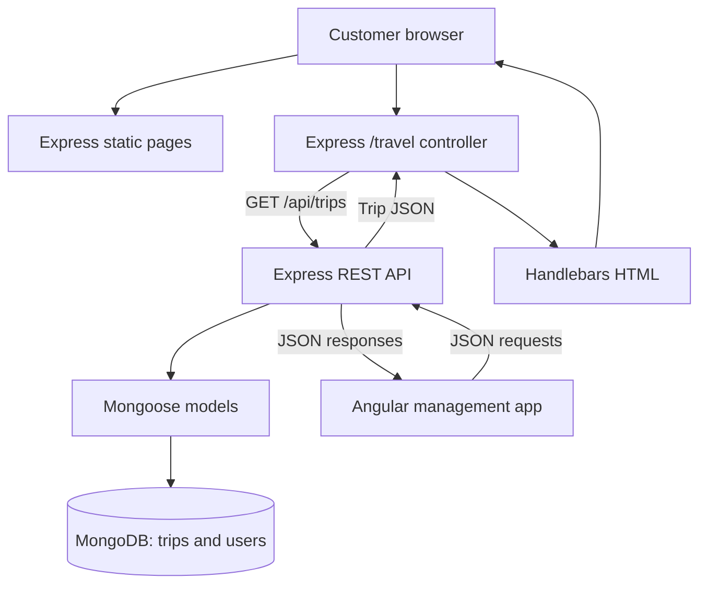
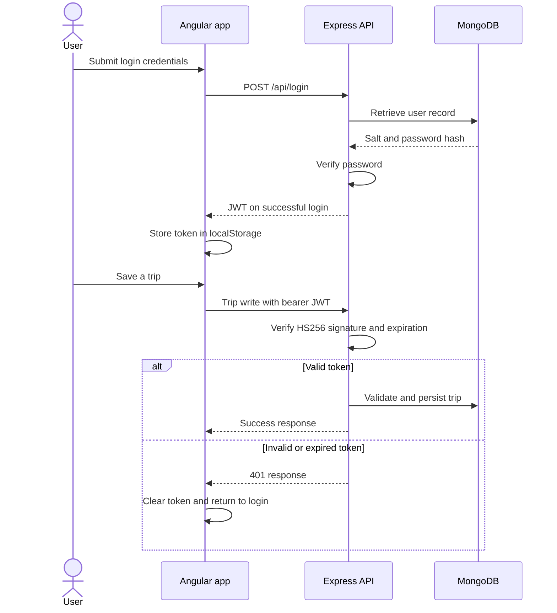

# CS-465: Mean Time to Vacation

**Travlr Getaways | Trip manifest and operations logbook**

[](https://github.com/bradsaucier/mean-time-to-vacation/actions/workflows/ci.yml)

```yaml
STATUS  : MODULE EIGHT PORTFOLIO
AUTHOR  : Bradley Saucier
COURSE  : SNHU CS-465 - Full Stack Development I
SECTION : CS-465-11342-M01 | 2026 C-5
STACK   : MongoDB | Express | Angular | Node.js
LICENSE : UNLICENSED
```

> [!IMPORTANT]
> **BOTTOM LINE UP FRONT**
>
> One trip catalog, two interfaces, one API.
>
> Mission criteria:
> 1. `/travel` renders the trips returned by `GET /api/trips`.
> 2. Trip writes return `401` without a valid bearer token. See [authentication tests](test/auth.test.js).
> 3. Add and Edit share a form component, field definitions, and request conversion.
> 4. CI runs the Angular tests and build. Run the backend suite separately with `npm test`.

[Application](#application) | [Architecture](#architecture) | [Journal](#module-eight-journal) | [Run locally](#run-locally) | [Verification](#verification)

> [!TIP]
> **GRADER FAST PATH**
>
> 1. Journal: [Architecture](#architecture-reflection) | [Functionality](#functionality-reflection) | [Testing](#testing-reflection) | [Professional](#professional-reflection).
> 2. Security checks: [authentication tests](test/auth.test.js) and [Module Seven Postman collection](postman/travlr-module7.postman_collection.json).
> 3. CI scope: [Verification](#verification) and [ci.yml](.github/workflows/ci.yml).

## Application

Travlr Getaways puts four seed trips in MongoDB, displays them on an Express customer site, and lets logged-in users manage them in Angular. Both interfaces use the same API. The repository name is a MEAN stack pun. The authentication tests are not.

| Workspace | Purpose | Local address |
| --- | --- | --- |
| Customer site | Public pages and travel information | `http://localhost:3000/` |
| Dynamic Travel page | Current trips rendered with Handlebars | `http://localhost:3000/travel` |
| Angular management app | Login, create, edit, and delete | `http://localhost:4200/` |
| Trip API | Shared data access | `http://localhost:3000/api/trips` |

This is a trip catalog and management application. Booking, payments, and contact-form processing are outside its implemented scope.

## Architecture

Express serves the static customer pages. Its `/travel` controller fetches trip JSON from `/api/trips` and passes it to Handlebars. Angular requests JSON directly and builds the management views in the browser. Mongoose connects the API to MongoDB.



<details>
<summary>Repository map and earlier module artifacts</summary>

| Path | Purpose |
| --- | --- |
| [app.js](app.js), [bin/www](bin/www) | Active Express application and HTTP server |
| [app_server/](app_server/), [public/](public/) | Customer controllers, views, static pages, and assets |
| [app_api/](app_api/) | API routes, authentication, and Mongoose models |
| [app_admin/](app_admin/) | Angular components, services, and tests |
| [data/trips.json](data/trips.json) | Four seed trip records |
| [test/](test/), [postman/](postman/) | Backend tests and API collections |

The repository still contains `src/`, top-level `routes/` and `views/`, and `app_server/models/`. They are outside the active `npm start` path. `public/travel.html` is an accessible static copy; `/travel` displays database-backed content.

The Module Six Postman collection sends no Authorization headers. Its write requests will fail the current authentication check. Use the Module Seven collection for the final security iteration.

</details>

## Module Eight Journal

### Architecture Reflection

The customer site and management app solve different frontend problems. Express serves the public HTML pages and assembles the dynamic Travel page with Handlebars on each request. Angular loads a single-page application, then changes views and submits forms through client-side routes and HTTP requests. Server-rendered HTML suits the browsing side; the SPA supports repeated editing without loading a whole page after each action.

The JavaScript comparison needs one qualification: the customer pages contain no standalone browser JavaScript or script tags. In this repository, JavaScript runs the Express controller on Node.js, while Angular's compiled TypeScript runs in the browser. Plain browser JavaScript could update the DOM and fetch data directly, but Angular provides the component, routing, and form structure used here. The distinction is where the view is assembled and who manages its state.

MongoDB fits this catalog because one trip is one document: code, departure, price, description, and display fields belong together. The catalog has no cross-collection relationships requiring joins. MongoDB stores BSON, while the API exchanges JSON. Mongoose supplies the application rules through required fields, length limits, an experience-level enum, and a strict schema. A flexible database still needs a defined contract. I can see that separation directly in `data/trips.json`, the trip model, and the form that edits the same fields.

### Functionality Reflection

JavaScript executes logic; JSON carries data. JSON uses double-quoted keys and strings and cannot contain functions. Here, Express serializes trip records into JSON, Angular reads those responses through its data service, and the Travel controller uses the same API data to render HTML. Dates cross that boundary as strings, so both sides need an agreed interpretation. Using JSON connects the interfaces without requiring either one to know how MongoDB stores a record.

The shared trip form is the clearest example of refactoring through consolidation. Add and Edit use `TripFormComponent`, `FORM_FIELDS`, `buildTripForm()`, and `toTripInput()` instead of maintaining separate versions of the same form rules. The Edit component also reuses the Add component's submission and error-handling behavior, changing the load and save operations it needs.

The departure date shows why this reuse matters. `toTripInput()` converts it to noon UTC, and the trip card displays it in UTC. Both screens use that conversion, keeping the departure on the intended calendar date. One change to the shared field metadata updates labels, limits, or hints in both forms. Trip cards, data services, notice services, and Handlebars partials provide similar reuse for display and feedback. The benefit is fewer repeated fixes and more consistent behavior. There is still a maintenance cost: Angular validators and the Mongoose schema are separate, so a changed rule must stay consistent across both.

### Testing Reflection

A method defines the operation, and an endpoint identifies the API location. `GET /api/trips/:tripCode` reads a trip; PUT updates its editable fields; DELETE removes it. The method also affects access requirements. Reads are public, while writes require a token. Testing needs to check status codes, response content, and resulting state. A `201` response is more useful when a following GET retrieves the new trip, just as deletion should be followed by a missing-record check. Invalid dates, duplicate codes, and incomplete forms need separate cases.

The authentication suite makes an important negative assertion. It sends eleven missing or invalid Authorization-header cases to each write route, then checks that the mocked write functions were never called. That establishes rejection before persistence, but mocks cannot establish that MongoDB stored a valid request. Database integration tests and the live Postman suite serve that separate purpose.

Security also adds setup requirements. An expired token must be generated deliberately, and a valid test token must use the server's signing secret. `scripts/postman-environment.js` supplies expired and wrong-secret tokens for those cases. API tools can inspect CORS headers, but a browser is needed to check browser enforcement. I also distinguish authentication from authorization: this application verifies identity for writes without assigning administrator roles. Separating those concerns helps me explain what a test proves and what still needs verification.

### Professional Reflection

CS-465 brought the interface, API, and database into one project. A price entered in Angular passes through form validation, API field selection and normalization, and Mongoose validation before storage. That request path gives me a concrete way to explain the work to an employer, from a user's action to the stored record.

The skills represented here include Express routing, Angular reactive forms, reusable components, MongoDB modeling, JSON interfaces, PBKDF2 password hashing, and JWT middleware. The authentication tests add another useful example: checking that a rejected request changes nothing. These are specific implementations I can discuss rather than listing technologies without showing how they work together.

For future software work, this course gives me a foundation for building across application layers and reviewing their interactions. It also gives me a portfolio project with clear limits. Explaining why a client-side guard cannot secure an API, or why a passing CI badge covers only certain checks, demonstrates technical judgment alongside implementation skills. Those are abilities I can carry into development, testing, and code review without claiming that one course established mastery of every layer.

## API contract

Trip codes contain four letters followed by six digits. Valid codes are normalized to uppercase for lookups.

| Method and route | Access | Successful response |
| --- | --- | --- |
| `GET /api/trips` | Public | `200`, trips sorted by departure |
| `GET /api/trips/:tripCode` | Public | `200`, matching trip |
| `POST /api/trips` | Bearer JWT | `201`, trip and `Location` header |
| `PUT /api/trips/:tripCode` | Bearer JWT | `200`, updated trip |
| `DELETE /api/trips/:tripCode` | Bearer JWT | `204`, empty response |
| `POST /api/register` | Public | `200`, token for the new account |
| `POST /api/login` | Public | `200`, token after credential verification |

Invalid input returns `400`, rejected authentication `401`, missing trips `404`, and duplicate trip codes or registration emails `409`. PUT requires the complete editable fields and preserves the trip code. Controllers select allowed input fields before validation and persistence.

`GET /health` reports server liveness, not MongoDB readiness.

### Authentication flow

Login checks the password against a salted PBKDF2 hash and issues a one-hour JWT. Angular stores it in localStorage and attaches it through an HTTP interceptor. Express verifies the signature, HS256 algorithm, and expiration before allowing a trip write to proceed.



**Access boundary:** Registration is public and there are no roles. Anyone who can reach the API can register and then create, edit, or delete trips. A public deployment would need controlled access and server-enforced permissions.

The Angular guard checks the token's expiration claim, not its signature. A forged token with a future expiration can pass that navigation check, but the API rejects its writes and the interceptor clears it. [Angular's route-guard guidance](https://angular.dev/guide/routing/route-guards) explains why access control must also run on the server. CORS is separate: it controls browser access to responses, not caller identity. There is no refresh or revocation flow; an issued token normally remains valid until expiration.

## Run locally

Use npm, a reachable MongoDB server, and a Node.js version satisfying `^22.22.3`, `^24.15.0`, or `^26.0.0`, as declared in the package manifests. `.nvmrc` selects only major version 22. If using Node 22, check `node --version` and use patch 22.22.3 or later before running Angular commands.

Start at the repository root. The main examples use PowerShell.

### 1. Install and configure

```powershell
npm ci
npm run admin:install
Copy-Item .env.example .env
node -e "console.log(require('node:crypto').randomBytes(48).toString('hex'))"
```

Copy the generated value into `JWT_SECRET` in `.env`. The other defaults in [.env.example](.env.example) support the setup below: MongoDB at `127.0.0.1`, database `travlr`, backend port `3000`, and Angular origin `http://localhost:4200`. Keep `.env` private. Startup rejects a missing secret or the supplied placeholder.

On Bash, use `cp .env.example .env` for the copy step; the npm and Node commands are the same.

### 2. Prepare the database

Start your local MongoDB service first.

**Seed warning:** `npm run seed` validates the input, deletes every existing trip in the configured database, synchronizes indexes, and inserts the four seed trips. Trips added through the app are removed. User records are untouched. Use a disposable development database.

```powershell
npm run seed
npm run verify:db
```

### 3. Start both interfaces

In the first terminal:

```powershell
npm start
```

In a second terminal at the repository root:

```powershell
npm run admin:start
```

Open `http://localhost:3000/` for the customer site and `http://localhost:4200/` for the management app. Keep these default ports for this setup: Angular's API service points to `http://localhost:3000/api`.

### 4. Create an account and log in

Create an account through the API; the SPA has no registration screen. In PowerShell, choose a password when prompted:

```powershell
$credential = Get-Credential -UserName 'operator@example.test'
$account = @{
    name = 'Local Operator'
    email = $credential.UserName
    password = $credential.GetNetworkCredential().Password
} | ConvertTo-Json

Invoke-RestMethod -Method Post `
    -Uri 'http://localhost:3000/api/register' `
    -ContentType 'application/json' `
    -Body $account | Out-Null
```

<details>
<summary>Bash registration alternative</summary>

Replace the example password before running:

```bash
curl -X POST http://localhost:3000/api/register \
  -H 'Content-Type: application/json' \
  -d '{"name":"Local Operator","email":"operator@example.test","password":"choose-a-password"}'
```

</details>

Sign in at `http://localhost:4200/login` with the account's credentials. Registration returns `409` if that email already exists; use the existing account or choose another email.

## Verification

**It Worked on My Machine Is Not Evidence.** The badge reports the [CI workflow](.github/workflows/ci.yml), which configures Node.js 22.x and 24.x jobs for backend syntax checks, seed validation, Angular tests, and an Angular build. Seed validation in CI does not write to MongoDB.

| Check | Command | In CI |
| --- | --- | --- |
| Backend HTTP, model, and authentication tests | `npm test` | No |
| Angular tests | `npm run admin:test` | Yes |
| Angular build | `npm run admin:build` | Yes |
| Database content verification | `npm run verify:db` | No |
| Module Seven API collection | `npm run test:postman` | No |
| MongoDB integration tests | Enable flag, then `npm test` | No |

Run the commands to establish results for your checkout. The badge does not cover the backend suite, live MongoDB, or Postman.

### Database integration tests

These tests are skipped by default. With MongoDB running, use PowerShell:

```powershell
$env:MONGODB_INTEGRATION = '1'
npm test
Remove-Item Env:MONGODB_INTEGRATION
```

In Bash, use `MONGODB_INTEGRATION=1 npm test`. The integration suite forces the database name to `travlr_test` and replaces trip data there.

### Postman security suite

With Express and MongoDB running:

```powershell
npm run test:postman
```

This command generates a local environment using the server's `.env` secret and fetches Newman 6.2.3 from npm at runtime. Keep the generated environment file private.

**Postman writes to the running server's database**, which defaults to `travlr`, not `travlr_test`. Each successful run registers a new timestamped user and leaves it behind. It also creates and deletes `TEST000001`; an interrupted run can leave that trip behind. Use a disposable database and reserve that code for testing. The users collection keeps a guest book.

## Rights and references

The package declares `UNLICENSED`; this README grants no license. Course-supplied Travlr images and other third-party assets retain their respective rights.

- [JSON syntax and behavior - MDN](https://developer.mozilla.org/en-US/docs/Web/JavaScript/Reference/Global_Objects/JSON)
- [Documents and BSON - MongoDB](https://www.mongodb.com/docs/manual/core/document/)
- [Client-side route guards - Angular](https://angular.dev/guide/routing/route-guards)
- [Mermaid diagrams in Markdown - GitHub](https://docs.github.com/en/get-started/writing-on-github/working-with-advanced-formatting/creating-diagrams)
